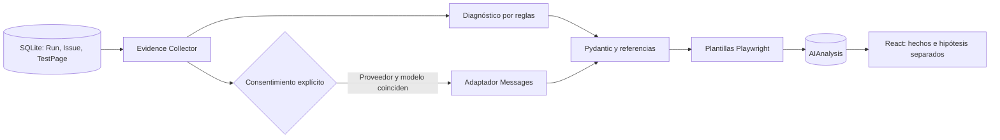

# Arquitectura — fase 5

## Estructura definitiva

El workspace ya es la raíz del monorepositorio: no se añade otra carpeta `blackbox-ai/`.

```text
backend/
  app/
    api/             salud, dashboard, proyectos, ejecuciones, evidencias e informes
    core/            configuración, motor SQLite, sesiones y ámbito de workspace
    models/          Project, Run, Issue, TestPage, AIAnalysis y enumeraciones
    repositories/    proyectos, resultados, progreso y agregaciones del dashboard
    schemas/         contratos de respuesta Pydantic
    services/        coordinación, informes, comparación, reglas y adaptador LLM
    testing/         Chromium, demo integrada, política y almacén de evidencias
    main.py          aplicación ASGI, recuperación y cierre
  alembic/versions/  historial de migraciones
  tests/             integración HTTP + SQLite temporal real
  data/              datos locales ignorados por Git
frontend/
  src/
    components/      shell, formulario reutilizable, diálogo de borrado y estados
    hooks/           carga, cancelación y recarga
    pages/           dashboard, proyectos, historial y progreso/resultados de análisis
    services/        cliente HTTP con timeout
    types/           contratos TypeScript
docs/
scripts/             arranque independiente desde PowerShell
```

Los paquetes no incluyen módulos vacíos para funciones futuras.

## Flujo

React → cliente HTTP común → FastAPI → repositorios SQLAlchemy → SQLite.

Salud y dashboard conservan sus rutas `/api/v1`. Proyectos reutiliza un router bajo `/api/v1/projects` y `/api/projects`; no hay dos implementaciones ni dos conjuntos de datos. La API devuelve listas paginadas (por defecto 20, máximo 100), y el frontend recorre páginas de 12.

Un proceso de backend y un proceso Vite. El análisis es una tarea asyncio con un Chromium headless, un contexto y una pestaña de recorrido. Las transacciones de progreso se ejecutan en hilos, con sesiones independientes y esperas protegidas frente a cancelación. La interpretación posterior usa reglas o una petición LLM opcional. No hay colas externas, contenedores, GPU ni modelos locales.

Las migraciones se ejecutan explícitamente antes de servir (el script de arranque lo hace). El servidor no utiliza `create_all`, no borra datos ni crea registros de demostración. La ruta relativa de la base se resuelve contra `backend/`, incluso si se llama Alembic desde otra carpeta.

## Datos y semántica

- `Project`: nombre, descripción, URL base, ámbito de workspace, fechas y límites históricos de páginas (1–50), profundidad (0–5) y duración (10–300 s). Esos límites son de solo lectura en el CRUD del proyecto; las ejecuciones usan los límites propios descritos a continuación.
- Esos límites históricos de proyecto se conservan. Cada nueva ejecución recibe límites propios, con valores predeterminados 10 páginas, profundidad 2, navegación 15 s, global 120 s y 100 peticiones. Sus máximos de API son 20, 3, 30 s, 180 s y 200 respectivamente.
- `Run`: proyecto, estado, páginas visitadas y fechas. El contador «Análisis ejecutados» incluye todas las ejecuciones registradas, también en cola. «En cola o en ejecución» suma ambos estados activos.
- Se amplía `Run` con workspace, destino inmutable, límites JSON, contador de incidencias/peticiones, duración, mensaje de error, cancelación y slot activo. `TestRun` es un alias del modelo existente, no una tabla duplicada. La API presenta `pending` para el `queued` histórico, conservando restricciones y datos anteriores.
- `Issue`: ejecución, tipo, severidad, descripción, URL, evidencia opcional, reproducción, estado y fecha. El proyecto se obtiene mediante la ejecución para evitar inconsistencias entre dos claves de proyecto.
- `TestIssue` reutiliza `Issue`, añadiendo título; `TestPage` persiste URL redactada, código HTTP, tiempo, profundidad, fecha y captura. Las decisiones de política se registran como incidencias informativas y se distinguen por tipo/severidad de los fallos HTTP/JS.
- «Errores detectados» y «Errores críticos» cuentan todos los hallazgos históricos, independientemente de su estado de resolución.
- Gráfico: 14 fechas UTC, incluida hoy. Cada serie agrupa por la fecha de creación del registro correspondiente. El historial muestra las 8 ejecuciones más recientes; la vista de proyectos, los 5 proyectos más recientes.
- Las fechas se guardan en UTC y se devuelven con zona explícita; las horas de la interfaz usan la zona del navegador.
- SQLite impone claves foráneas, borrado en cascada, enumeraciones y límites. El borrado confirmado en la interfaz elimina también las ejecuciones y errores asociados. PATCH solo cambia los campos presentes y actualiza la fecha cuando hay modificaciones reales.

La migración de fase 2 añade `description` (vacía para registros anteriores) y `workspace_id` (`local` para registros anteriores), junto con un índice. No recrea la tabla de proyectos ni elimina sus relaciones. Se verifica la conservación de proyectos, ejecuciones y errores con datos de fase 1 antes de aplicar la migración.

La migración de fase 3 añade columnas e índices a `runs`, título a `issues` y la tabla `test_pages`, sin reconstruir las tablas anteriores. Rellena el workspace/destino de ejecuciones antiguas desde su proyecto y cuenta sus incidencias existentes. Los tests verifican conservación y downgrade/upgrade. Los datos de desarrollo se respaldaron antes de aplicar cada migración.

## Ejecución y ciclo de vida

1. La API verifica workspace, consentimiento booleano explícito, activación de demo y origen permitido. Congela URL/límites y guarda una ejecución pendiente con `active_slot=1`.
2. `RunManager` crea una tarea y responde 202. No hay cola en memoria: una segunda ejecución recibe 409.
3. El slot único de SQLite es global, incluso entre workspaces. Un bloqueo de archivo por base impide dos procesos API/coordinadores simultáneos. Las mutaciones del proyecto y la creación de análisis se serializan con transacciones SQLite inmediatas.
4. El worker marca running y arranca `DemoEngine`. El recorrido BFS usa URLs normalizadas, conjunto de visitadas, profundidad, máximo de páginas/peticiones y deadline.
5. Cada página escribe una transacción con sus incidencias y progreso. La cancelación espera a terminar una escritura ya iniciada, evitando finalizar el run antes de sus registros.
6. Cancelar o vencer el deadline interrumpe el trabajo; el `finally` cancela handlers pendientes, cierra contexto/navegador y detiene el driver. Solo entonces se guarda el estado final y se libera el slot. Los tiempos incluyen preparación y limpieza; la limpieza puede exceder el deadline de navegación.
7. Un cierre normal solicita cancelación. En el siguiente arranque, cualquier pending/running interrumpido pasa a failed por reinicio, aun si se arranca sin habilitar la demo. No hay reintentos de navegación ni reanudación automáticos.

En Windows, la ejecución requiere ProactorEventLoop. Uvicorn con recarga o múltiples workers usa un bucle distinto en la versión instalada; la demo rechaza ese modo de arranque con un mensaje explícito. El script y la documentación usan un worker sin recarga.

Se mantienen resultados parciales al fallar o cancelar. Las capturas se escriben de forma atómica bajo IDs UUID y se eliminan si falla su persistencia de página. La eliminación confirmada de un proyecto finalizado borra sus filas por cascada y sus archivos conocidos; fallos del sistema de archivos pueden dejar evidencias huérfanas para limpieza administrativa. No se hace borrado recursivo de rutas introducidas por usuarios.

## Red y alcance de seguridad

El CRUD registra URLs como datos y no realiza DNS, peticiones HTTP ni navegación hacia ellas. El validador comprueba sintaxis HTTP/HTTPS, longitud y ausencia de credenciales, consultas y fragmentos. Los errores de validación no devuelven los valores de entrada. React representa nombre, descripción y URL como texto, sin HTML dinámico ni enlaces externos a la URL del proyecto. Las consultas usan SQLAlchemy y parámetros enlazados.

`get_workspace_access` proporciona un ámbito `local` controlado por el servidor. Todos los métodos del repositorio de proyectos y las agregaciones del dashboard aplican ese ámbito. Los campos de entrada de proyectos prohíben propiedades adicionales, como workspace, identificadores, fechas o límites. Esta dependencia se sustituirá por membresía autenticada cuando se implemente identidad; no acepta un workspace mediante cabeceras de cliente. Registrar un proyecto no concede autorización para testing.

Las rutas de ejecuciones, incidencias, páginas, cancelación y PNG verifican tanto el workspace de la ejecución como el de su proyecto. Los archivos no se montan como un directorio estático. El cliente recibe URLs de API, no rutas del disco.

CORS admite únicamente los orígenes locales configurados y los métodos GET/POST/PATCH/DELETE; no sustituye autenticación. Los scripts enlazan ambos servidores a `127.0.0.1`.

### Alternativa controlada adoptada

La navegación remota y otros servidores locales permanecen deshabilitados. Se usa el origen virtual fijo `http://blackbox-demo.invalid`, servido por un catálogo de HTML/JS integrado. Solo GET y ese origen se aceptan; cada solicitud se resuelve con `route.fulfill` o `route.abort`, nunca con `continue_`/`fetch` al destino. No hay resolución DNS de destino ni entradas de hosts aportadas por el cliente.

Antes de devolver una redirección se valida su Location. Una redirección prohibida produce una respuesta local bloqueada y una incidencia, sin contactar su destino. Se bloquean subrecursos externos, iframes, WebSockets, métodos de escritura y Service Workers. Las descargas se rechazan; el crawler excluye enlaces de acciones y archivos. La inspección de formularios solo observa sus etiquetas.

Chromium se inicia sin GPU, con resolución de nombres deshabilitada y proxy sin salida como defensa adicional. Esto no es un aislamiento de red del sistema operativo ni una garantía para contenido remoto arbitrario. No se permite HTML/JS suministrado por usuarios. El contenido controlado evita la superficie de páginas ajenas; las pruebas de rebinding comprueban rechazo y ausencia de resolución, no un mecanismo general de fijación de IP.

La demo tiene activación explícita (deshabilitada por defecto y prohibida en production) y consentimiento por ejecución. Para habilitar sitios reales en el futuro será necesario definir y probar aislamiento de egress, verificación DNS/IP y redirecciones/subrecursos en esa arquitectura. La fase 3 no habilita ese modo.

Los mensajes se redactan antes de persistirlos, y las URLs se guardan sin consultas, credenciales ni fragmentos. Las capturas enmascaran todos los campos y bloques sensibles conocidos de la demo; su alcance está acotado al contenido integrado. No se almacenan cuerpos de peticiones, cookies ni cabeceras de autenticación. El motor no utiliza un LLM para navegar ni ejecuta comandos arbitrarios; la interpretación de IA está separada y solo consume resultados ya finalizados.

## Frontend y comprobación

El detalle del proyecto integra autorización, límites e historial. El cliente lee primero el estado de la ejecución y después sus colecciones para evitar que una lectura terminal deje datos pendientes de consultar. Mientras está activa se consulta cada 1,5 s, sin solapar consultas; se cancelan lecturas al navegar y se detiene el polling al finalizar o ante errores.

La pantalla `/runs/{id}` muestra presupuesto recorrido, contadores, duración, cancelación, incidencias filtradas y capturas. La prueba local de navegador recorre estos flujos con SQLite temporal, revisa imágenes, ausencia de errores JS y menú/desbordamiento móvil. Las capturas de QA se inspeccionan como parte de la verificación y quedan fuera de Git.

No existe autenticación multiusuario ni despliegue SaaS en esta fase. No expongas este entorno local a redes públicas. El acceso a documentación API es solo de desarrollo. `frontend/.env` es configuración pública y nunca debe contener secretos.

## Informes, comparación y analítica

`api/reporting.py` añade siete GET bajo `/api/v1`, reutilizando `get_session`, `get_workspace_access`, `scoped_run` y los modelos existentes. El servicio `services/reporting.py` construye una representación acotada del resultado persistido, redacta datos y ofrece renderizadores HTML/PDF/JSON/CSV. No modifica las ejecuciones, los hallazgos ni sus estados. Las descargas pasan por el ámbito tanto de `Run` como de `Project`; no basta con conocer un UUID. Los informes y comparaciones requieren ejecuciones finalizadas con `finished_at` registrado.

### Consultas y límites

- Resumen por ejecución: `COUNT`, `AVG`, agrupaciones de severidad/tipo y sumas condicionales para HTTP, JavaScript/consola y enlaces rotos. Estos últimos contadores no dependen del recorte de 50 tipos.
- Informe: como máximo 200 incidencias y 20 páginas, orden estable por fecha e ID, textos de hasta 4000 caracteres (título 200, URL 2048). Los totales y las omisiones se obtienen mediante SQL; no se deducen del número de detalles incluidos.
- Analítica de proyecto: subconsulta de IDs dentro del workspace, agregaciones SQL sobre sus incidencias/páginas y paginación de ejecuciones (20 por defecto, máximo 50). No se cargan relaciones ORM de todas las ejecuciones. Los agregados por ejecución se restringen a los IDs de esa página.
- La regresión del proyecto corresponde a sus dos últimas ejecuciones finalizadas. Solo se cargan sus colecciones acotadas; no se recompara todo el histórico. Si no hay dos ejecuciones ordenables por fecha, se devuelve `null`.
- Se reutilizan índices existentes: `projects.workspace_id`, `runs.project_id`, `runs.workspace_id`, `runs.created_at`, `issues.run_id` y `test_pages.test_run_id`. Los informes no requieren nuevos índices ni columnas. La fase 5 añade su tabla independiente mediante `d51e09a3b842`; `alembic check` comprueba la correspondencia completa.
- HTML/PDF se generan bajo demanda, con un semáforo por proceso que permite una generación a la vez y rechaza contención con 409. Las rutas síncronas se ejecutan en el threadpool de FastAPI; no se bloquea el bucle asyncio del motor. No se crea una cola ni un servicio adicional.

### Renderizado offline y privacidad

HTML usa únicamente texto escapado, CSS incorporado y PNG en data URLs. No hay scripts, fuentes externas, enlaces activos de destino ni HTML aportado por una página. Incluye CSP restrictiva también dentro del archivo para conservar la protección al descargarlo. PDF usa ReportLab Platypus, tipografía Vera incluida, párrafos con marcado escapado, tablas, cabeceras y numeración. No utiliza Chromium ni interpreta el HTML descargable. La fuente soporta español; caracteres sin glifo se sustituyen por `?`, con aviso en portada.

Las capturas opcionales se buscan desde IDs de páginas pertenecientes al mismo análisis y su nombre UUID exacto. `EvidenceStore.path` rechaza traversal, symlinks y junctions que resuelvan hacia otra ruta, incluso dentro del directorio de evidencias. Nunca se abre `Issue.evidence_path` como una ruta. Se comprueba tamaño antes y durante la lectura, se decodifica PNG de una sola imagen con Pillow, se exige como máximo 1920×1080 y se recodifica a RGB sin metadatos. Presupuestos: 4 capturas, 3 MB por archivo y 4 MB acumulados; HTML/PDF indican las omisiones. Una captura corrupta o ausente no impide exportar el texto.

Los export no incluyen rutas internas, workspace, cookies, cabeceras ni el mensaje interno de error del servidor. Se redactan patrones conocidos de secretos, correos y rutas locales también en históricos. No hay un detector universal de secretos y no se aplica OCR a capturas: la interfaz las deja desmarcadas e indica revisarlas antes de compartir. Los informes fallidos/cancelados conservan una advertencia explícita de parcialidad.

JSON tiene `schema_version=1`, datos de proyecto/ejecución, resumen, incidencias, páginas y omisiones; no incrusta archivos. CSV cita todas las celdas, utiliza UTF-8 con BOM y antepone apóstrofo a posibles fórmulas, incluso con espacios iniciales. Incluye ID/estado del análisis, total y omisiones en cada fila; sin hallazgos, una fila de metadatos conserva los ceros. Los filenames solo contienen UUID y extensión fija; las respuestas usan attachment, no-store, nosniff y un máximo de 12 MB para exportaciones. Las referencias de evidencia en JSON/CSV son IDs de página, no rutas de disco.

### Equivalencia y cobertura

Huella v1: SHA-256 de `[tipo, URL normalizada, título + descripción normalizados]`. Se elimina consulta/fragmento, se normalizan esquema/host/puerto predeterminado, espacios y mayúsculas del mensaje; UUID, fechas ISO y duraciones con unidades se sustituyen por marcadores. No se usan IDs de registro, severidad, fecha de creación ni métricas temporales. Se conservan rutas, códigos HTTP y números técnicos restantes. No hay un identificador técnico separado en el modelo actual: la información disponible procede del tipo y mensaje registrado.

Los duplicados de una huella se agrupan. PERSISTENT aparece en ambos lados; NEW solo en destino. Una ausencia es RESOLVED únicamente si ambos estados son completed, destino y límites coinciden, no hay omisiones ni incidencias de timeout/navegación/presupuesto, no se ha alcanzado el techo de 200 hallazgos y el destino contiene una navegación registrada a la URL afectada sin bloqueo. Las demás ausencias son UNCONFIRMED. La comparación se marca parcial si falla alguna condición o quedan ausencias sin confirmar. Estas reglas son conservadoras y se aplican también a las tarjetas de la analítica.

La resolución solo significa «no observado en esta revisita». Recorridos con distintos tiempos, mensajes modificados o URLs dinámicas pueden producir falsos positivos o negativos. NEW tampoco prueba que el defecto se haya introducido entre ejecuciones. No se modifica `Issue.status`. Las cifras de regresión cuentan grupos; las gráficas históricas y totales cuentan registros persistidos, incluidas ejecuciones parciales y hallazgos informativos.

Los registros antiguos sin `Run.target_url` muestran «Destino no registrado». No se atribuye al análisis histórico la URL actual del proyecto, que puede haberse editado. La falta de ese destino impide afirmar resoluciones en comparaciones.

### Interfaz

`ReportPanel` amplía `RunDetail`; `ComparisonPanel` se comparte entre `/runs` y `/reports`; `ProjectAnalytics` amplía el detalle de proyecto. `services/reporting.ts` centraliza llamadas, etiquetas y descargas; estas reutilizan el mismo manejo HTTP de `services/api.ts`, con timeout de 60 s para generar archivos y 10 s para consultas habituales. La descarga usa blobs y revoca sus URLs temporales.

Las listas de proyectos y ejecuciones para comparar son paginadas, conservan selecciones de otras páginas y rechazan el mismo análisis en ambos lados. Los datos seleccionados se vuelven a validar en el servidor. Recharts se carga con importación dinámica, compartiendo su chunk entre dashboard y analítica. Las vistas incluyen errores, reintentos, ausencia de datos y filtros. No hay HTML de resultados insertado mediante `dangerouslySetInnerHTML`.

## AI Intelligence

La rama de fase 5 parte del commit final de fase 4, sin reconstruir ni fusionar las ramas anteriores. La interpretación es posterior al testing: solo recibe ejecuciones finalizadas. No puede cambiar el alcance del crawler, enviar formularios, ejecutar propuestas o modificar resultados históricos.



### Evidencias y reglas

`services/ai_evidence.py` reutiliza `reporting.report_data`, su redacción y ámbito de workspace. Selecciona como máximo 20 incidencias y 10 páginas del documento acotado; conserva URLs completas, tipo, severidad, mensajes limitados, códigos HTTP, tiempos y referencias de capturas. No abre archivos de evidencia ni incorpora bytes de imagen. El resumen SQL mantiene los totales aunque se omitan detalles.

Una consulta indexada obtiene solo la ejecución finalizada inmediatamente anterior del proyecto y workspace, si se solicitó histórico. Se reutiliza `reporting.compare` y se retienen únicamente sus recuentos/indicador de parcialidad. No se carga todo el histórico. Las agrupaciones usan `reporting.fingerprint`, con un campo `source=deterministic`; un recorte de contexto mantiene coherencia entre incidencias y grupos y comunica omisiones.

La instantánea serializada tiene un límite de 12 000 bytes UTF-8. Los mensajes reconocidos como instrucciones o comandos se sustituyen por un aviso de cuarentena. Además de la redacción de fase 4, se elimina cualquier coincidencia literal de la clave backend configurada. Este filtro es una defensa limitada, no una clasificación infalible de contenido malicioso o secreto.

`services/ai_rules.py` devuelve `EngineResult` también cuando no se configura un proveedor. Usa reglas versionadas para HTTP, enlaces, JS, consola, timeout y etiquetas; lo desconocido reconoce información insuficiente. No representa sus respuestas como generación de un modelo. Las hipótesis de reglas tienen confianza baja y limitaciones explícitas; no añaden supuestos logs, código o acciones observadas.

### Proveedor y validación

`AnalysisProvider` es un protocolo asíncrono que devuelve una estructura `ProviderResult`. El primer adaptador `AnthropicProvider` usa HTTPX2 contra un único destino HTTPS fijo. No acepta un endpoint del usuario, no sigue redirecciones ni proxies del entorno y conserva validación TLS. Las claves se tipan `SecretStr`, se usan como cabecera de ese proveedor y nunca se incluyen en la instantánea, instrucciones o capacidades.

Las instrucciones SYSTEM y el JSON `untrusted_evidence` ocupan campos separados del protocolo Messages. No se envían herramientas ni se habilita thinking. `output_config.format` especifica un esquema JSON: se retiran solo las restricciones no admitidas por la API, que se vuelven a exigir mediante Pydantic estricto al recibir. Se rechazan contenido no textual, truncamiento, errores de formato y más de 128 000 bytes de respuesta decodificada. Los errores se convierten a categorías internas seguras, sin persistir cuerpo, cabeceras o excepciones arbitrarias.

`validate_result` comprueba límites, IDs existentes y no repetidos, al menos una incidencia por hallazgo/test, plantilla compatible y URL utilizable. Las URLs nuevas, comandos, código fuente no aportado, afirmaciones explícitas de causa confirmada y códigos HTTP no observados se rechazan. Los demás textos se redactan antes de guardar. Estas validaciones refuerzan el contrato; no prueban la veracidad semántica de cada frase. La UI conserva la etiqueta de hipótesis sin confirmar incluso si la confianza cualitativa del modelo es alta.

El proveedor devuelve planes de test, nunca un campo libre de código. `render_tests` construye tres plantillas Python conocidas: respuesta HTTP <400, ausencia de pageerror o ausencia de consola error durante navegación. Elige una incidencia citada compatible, usa su ruta completa y la serializa como un literal para evitar inyección de Python. Si falta URL, el modo reglas omite la propuesta y un plan LLM incompatible se rechaza. BASE_URL queda como marcador explícito para un entorno autorizado. El código solo se muestra/copia: no hay endpoint de ejecución, shell, acceso arbitrario a archivos ni aplicación automática de correcciones.

### Tareas, consentimiento y cuotas

`AIManager` vive en el lifespan, después de adquirir el bloqueo de proceso existente. POST valida ámbito/estado y crea una fila con una transacción corta `BEGIN IMMEDIATE`; el trabajo continúa en una tarea asyncio. Las consultas/escrituras SQLite usan sesiones independientes en hilos, protegidas para que una cancelación no deje una escritura en segundo plano sin esperar. Una restricción única del slot activo permite una sola interpretación por base de datos. El motor Playwright mantiene su slot independiente.

LLM exige `authorize_external` booleano estricto y los nombres de proveedor/modelo confirmados, iguales a la configuración actual. Se validan antes de consultar caché o reservar consumo. Rules no necesita autorización externa ni clave. El hash de caché incluye contexto redactado, modo, proveedor, modelo, máximo de hipótesis y `prompt_version`; solo se reutilizan pending/running/completed. Los fallos se pueden volver a solicitar dentro de las cuotas; no hay reenvío automático.

Las cuotas por workspace se consultan mediante agregaciones SQL sobre fechas UTC y reservas persistidas, dentro de la misma transacción. Los intentos adicionales, fallos y cancelaciones se reservan conservadoramente y no se reembolsan. Los límites por defecto, fórmula de tokens y tarifas opcionales están en el README. Los precios son configuración explícita; no se presupone coste monetario conocido si faltan. Estas estimaciones son controles locales y no sustituyen los límites de la cuenta comercial.

Cada intento está limitado por timeout y el trabajo completo tiene un plazo máximo. Solo 429/502/503/529 permiten un reintento, con máximo configurable de uno y pausa de 1 s. Se ofrece cancelación; puede no revertir un cargo externo ya iniciado. Al cerrar se cancelan/esperan las tareas y se libera el slot incluso si la tarea aún no había empezado. Al arrancar, las filas interrumpidas pasan a failed; no se contacta al proveedor para reanudarlas. Un fallo de IA no cambia las incidencias originales ni impide usar informes/CRUD.

### Persistencia y frontend

La migración `d51e09a3b842` añade `ai_analyses`, sin modificar las tablas previas. Guarda IDs, workspace, proveedor/modelo/modo/estado, instantánea redactada, resultado estructurado, versión/hash, fechas, consentimiento y reservas/uso comunicado. No almacena cadena de pensamiento ni prompts/respuestas brutos. La FK a runs elimina interpretaciones al borrar el proyecto; se impide borrar/editar un proyecto con una interpretación activa.

Índices nuevos: slot activo único, `(run_id, created_at)` para historial/caché/cuota por ejecución y `(workspace_id, created_at)` para límites diarios/cooldown. Las lecturas unen AIAnalysis, Run y Project y exigen los tres ámbitos. El histórico está paginado (5 por defecto, máximo 20); no se devuelve una colección ilimitada.

`AIIntelligencePanel` amplía RunDetail con modal, creación, polling y selección de resultados guardados. `AIAnalysisResult` se comparte con `/ai-analyses/:id` y separa hechos, hipótesis, recomendaciones, relaciones hipotéticas y código. Sus citas abren las evidencias usadas; las capturas se consultan mediante la ruta protegida existente y nunca se envían al modelo. El portapapeles es una acción expresa del usuario. Las claves no forman parte de ningún contrato TypeScript ni variable VITE_.

## Referencias técnicas

- [FastAPI: CORS](https://fastapi.tiangolo.com/tutorial/cors/) para configurar orígenes explícitos.
- [Alembic: tutorial](https://alembic.sqlalchemy.org/en/latest/tutorial.html) para versionar el esquema.
- [Vite: requisitos de Node y arranque](https://vite.dev/guide/) para ejecutar el frontend.
- [FastAPI: actualizaciones parciales](https://fastapi.tiangolo.com/tutorial/body-updates/) para conservar campos omitidos en PATCH mediante `exclude_unset`.
- [Playwright: interceptación y Service Workers](https://playwright.dev/python/docs/network) para el control de solicitudes del contexto.
- [Playwright: cierre del navegador](https://playwright.dev/python/docs/api/class-browser#browser-close) para el ciclo de vida de los recursos.
- [ReportLab: Platypus](https://docs.reportlab.com/reportlab/userguide/ch5_platypus/) y [párrafos](https://docs.reportlab.com/reportlab/userguide/ch6_paragraphs/) para PDF sin navegador y tratamiento seguro del marcado.
- [Python CSV](https://docs.python.org/3.12/library/csv.html) para serialización y escapes del formato.
- [Anthropic: salidas JSON estructuradas](https://platform.claude.com/docs/en/build-with-claude/structured-outputs) para el contrato y restricciones de esquema del adaptador inicial.
- [HTTPX2](https://github.com/pydantic/httpx2) para transporte HTTP asíncrono, límites y transportes de evaluación controlados.
